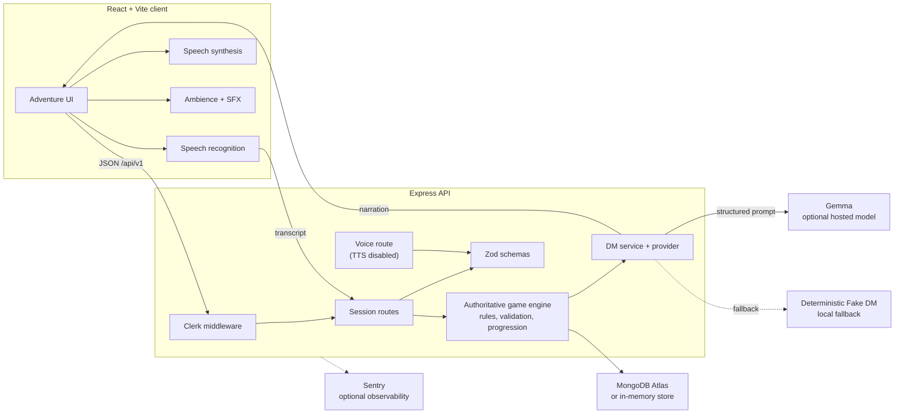

# DungeonsDaily
Voice-driven fantasy fitness RPG. **Gemma is the open-weight AI core** (Dungeon Master);
the game engine is the authoritative rules layer.

> One user + one adventure + voice + exercise + dynamic story + persistent session.

## Features

- **Voice-first workouts:** browser-native speech recognition and speech
  synthesis let players talk with the Dungeon Master while keeping typed
  input as a fallback.
- **Dynamic fantasy narration:** Gemma generates structured Dungeon Master
  turns through the AI provider layer; a deterministic Fake DM keeps the
  core loop available without an API key.
- **Authoritative game rules:** the game engine validates exercises, health,
  XP, progression, scene transitions, and session completion independently
  of the model's narrative output.
- **Workout-sized adventures:** sessions support 10-, 20-, and 30-minute
  durations with exercise completion tracked against the current challenge.
- **Persistent session history:** MongoDB stores users, sessions, and recent
  turns, with an in-memory store available for local development.
- **Secure API boundaries:** Clerk protects session and user routes while
  the health endpoint remains public for deploy checks.
- **Immersive audio:** environment ambience and sound effects run in the
  browser, duck during narration, and can fail or be muted without blocking
  gameplay.
- **Operational visibility:** structured validation, centralized errors,
  request logging, and optional Sentry tracing support production debugging.

## Stack

- Node.js + TypeScript + Express + pnpm workspaces
- MongoDB Atlas (`mongodb` driver, singleton client)
- Gemma via Vercel AI SDK (`generateText` + `Output.object` + `@ai-sdk/google`)
  with `GOOGLE_GENERATIVE_AI_API_KEY` (server-side only).
  Default model `gemma-4-31b-it`; swap via `GEMMA_MODEL`.
- Clerk authentication and browser-native speech recognition/synthesis
- Sentry (errors + AI tracing, on when `SENTRY_DSN` set)
- Zod validation, Vitest, React+Vite frontend

## Quickstart

1. Fill in `.env` at the repo root (placeholders are already there):

```env
MONGODB_URI=          # Atlas connection string (optional for dev — falls back to in-memory)
GOOGLE_GENERATIVE_AI_API_KEY=  # hosted Gemma key (optional — falls back to deterministic Fake DM)
GEMMA_MODEL=gemma-4-31b-it
ELEVENLABS_API_KEY=   # optional — game continues without TTS
ELEVENLABS_VOICE_ID=  # optional
```

2. Run:

```bash
pnpm install
pnpm dev
```

- API: http://localhost:4000 (`GET /api/v1/health` → `{"status":"ok"}`)
- Web: http://localhost:5173

Without keys the full loop works offline via the deterministic
Dungeon Master. Add a Gemma key for real narration; voice is browser-native.

## API

| Method | Path | Notes |
|---|---|---|
| GET | `/api/v1/health` | `{ "status": "ok" }` |
| POST | `/api/v1/sessions` | `{ userId, durationMinutes: 10\|20\|30 }` |
| GET | `/api/v1/sessions/:id` | session + recent turns |
| POST | `/api/v1/sessions/:id/response` | `{ text }` → next DM turn |
| POST | `/api/v1/sessions/:id/exercise/complete` | `{ exerciseId }` must match current |
| POST | `/api/v1/sessions/:id/end` | marks completed |
| GET | `/api/v1/users/:userId/sessions` | history |
| POST | `/api/v1/voice/synthesize` | disabled → `410 TTS_DISABLED` (browser speechSynthesis is used instead) |

Errors look like `{ "error": { "code": "SESSION_NOT_FOUND", "message": "..." } }`.

## Voice (browser-native, no paid services)

- **TTS:** the browser speaks DM narration with `window.speechSynthesis`
  (`apps/web/src/voice/useSpeechSynthesis.ts`). Auto-speaks each turn with
  configurable voice/rate/pitch/volume; English voice preferred and picked
  dynamically; TTS failure never blocks the game.
- **STT:** the browser listens with `SpeechRecognition` /
  `webkitSpeechRecognition` (`apps/web/src/voice/useSpeechRecognition.ts`,
  `continuous=false`, `interimResults=true`, `en-US`). Final transcripts
  auto-submit to the existing `POST /api/v1/sessions/:id/response` —
  the same pipeline as typed text. Text input fallback when unsupported
  or when microphone permission is denied.
- **Environment audio:** separate Web Audio ambience
  (`apps/web/src/voice/environmentAudio.ts`), ducked during narration.
- Server TTS is disabled: no audio is sent to or stored on the backend,
  and ElevenLabs is not used.

## Commands

```bash
pnpm install
pnpm dev                 # api + web together (turbo)
pnpm build               # turbo pipeline: shared → api + web, cached
pnpm test                # turbo pipeline
pnpm --filter @dungeonsdaily/api dev
pnpm --filter @dungeonsdaily/web dev
pnpm --filter @dungeonsdaily/api ai:check   # verify Google key → SDK → Gemma
```

## Render deployment

- Web service, build `pnpm install --frozen-lockfile && pnpm --filter @dungeonsdaily/api build`, start `pnpm --filter @dungeonsdaily/api start`
- Listens on `0.0.0.0` + `process.env.PORT`, exposes `/api/v1/health`
- Set secrets as Render env vars (same names as `.env.example`)

## Architecture



The model supplies narrative intelligence, but it never owns game state:
the game engine validates every transition before it is persisted. Optional
services degrade independently, so local development and the workout loop
remain usable without Gemma, MongoDB, or server-side TTS credentials.
